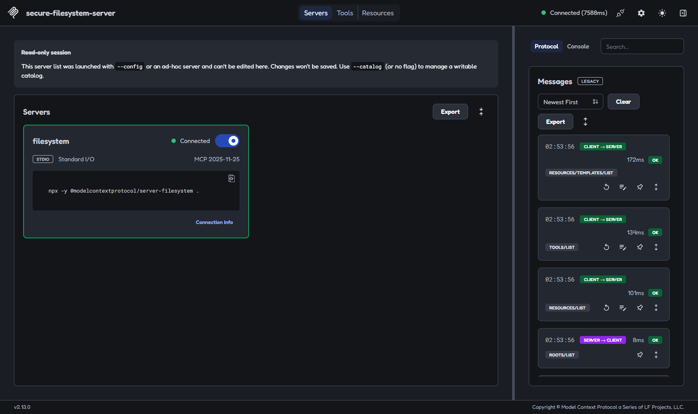
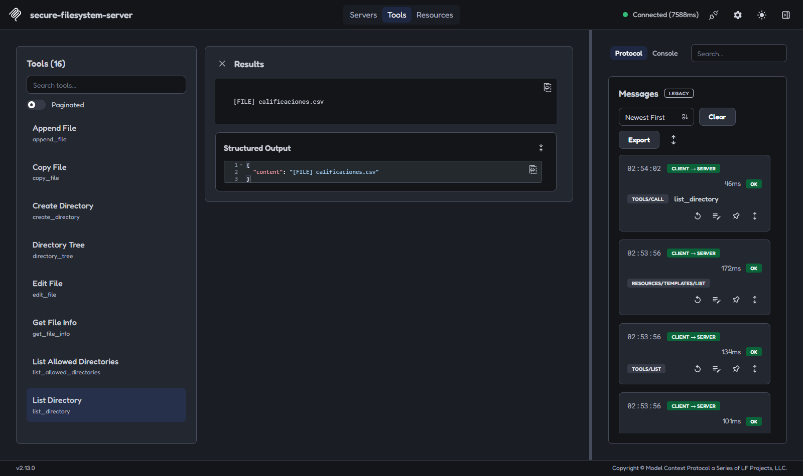
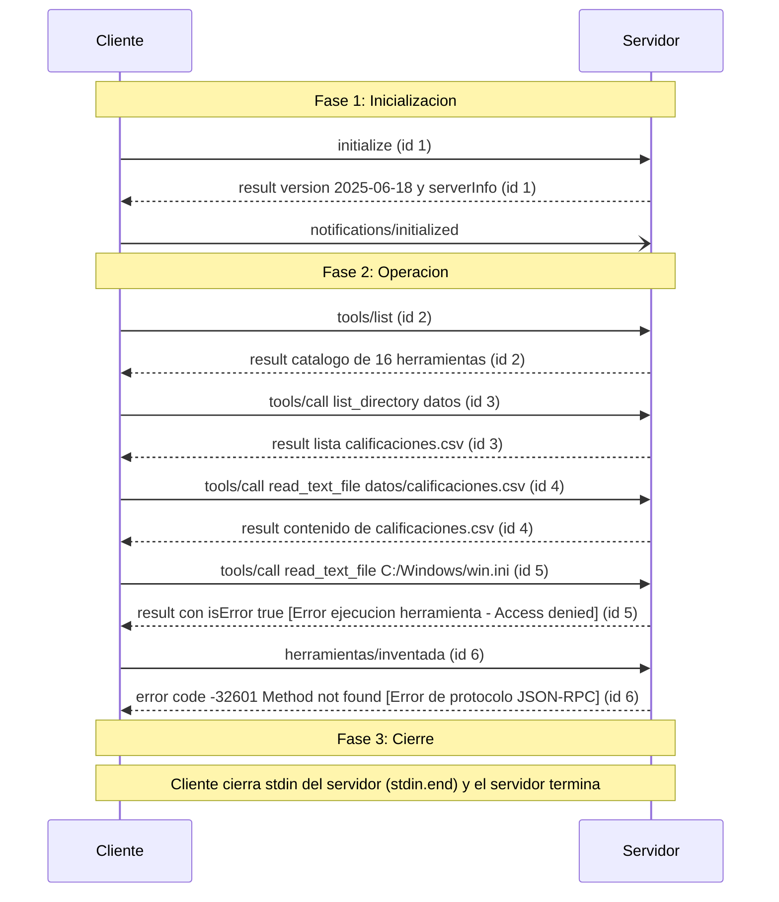

# Práctica 2: Ver el protocolo MCP por dentro
**Mensajes JSON-RPC con el MCP Inspector y con un cliente propio**

---

## 1. Descripción

Esta práctica consiste en inspeccionar, analizar y manipular a bajo nivel los mensajes del estándar **Model Context Protocol (MCP)** mediante el intercambio de objetos **JSON-RPC 2.0** a través del transporte de entrada/salida estándar (**stdio**). 

Se estudia a profundidad:
- Los tres tipos fundamentales de mensajes de JSON-RPC 2.0: **solicitud** (*request*), **respuesta** (*response*) y **notificación** (*notification*).
- El ciclo de vida de una conexión MCP: **inicialización** (*initialization*), **operación** (*operation*) y **cierre** (*shutdown*).
- Los mecanismos de negociación de versiones y declaración de capacidades (*capability negotiation*).
- El descubrimiento (`tools/list`) e invocación (`tools/call`) de herramientas expuestas por un servidor MCP.
- La diferencia crítica entre un **error de protocolo** (fallo en la semántica o enrutamiento JSON-RPC) y un **error de ejecución de herramienta** (fallo lógico dentro de la función de la herramienta manteniéndose el éxito a nivel de protocolo).
- La implementación paso a paso de un cliente MCP mínimo en JavaScript/Node.js sin dependencias de librerías externas.

### Entorno de trabajo utilizado
- **Sistema Operativo:** Windows 11 Pro (PowerShell)
- **Node.js:** v24.13.0
- **npm:** 11.6.2
- **MCP Inspector:** v2.13.0 (`@modelcontextprotocol/inspector`)
- **Servidor MCP Filesystem:** v2.3.0 (`@modelcontextprotocol/server-filesystem`, identificador interno `secure-filesystem-server`)
- **Navegador web:** Google Chrome

---

## 2. Requisitos y reproducción

### Requisitos previos
- Node.js versión 22.19 o superior (se utilizó v24.13.0).
- Git instalado y configurado.
- Conexión a internet para la descarga inicial de paquetes de npm.

### Instrucciones para reproducir la práctica

1. **Clonar el repositorio:**
   ```powershell
   git clone <URL_DEL_REPOSITORIO>
   cd practica2-mcp
   ```

2. **Estructura del proyecto:**
   Verificar que existan las carpetas `datos/`, `salida/` y `evidencias/`, así como el archivo de datos `datos/calificaciones.csv` y la configuración `mcp.json`.

3. **Reproducir la Actividad A (MCP Inspector):**
   - Ejecutar el Inspector vinculado al archivo de configuración:
     ```powershell
     npx -y @modelcontextprotocol/inspector --config mcp.json
     ```
   - Abrir en el navegador el enlace que imprime la terminal (comienza con `http://127.0.0.1:6274/?MCP_INSPECTOR_API_TOKEN=...`).
   - Activar el interruptor de la tarjeta del servidor `filesystem` para pasar de estado *Disconnected* a *Connected*.
   - En la pestaña superior **Tools**, seleccionar `List Directory`, introducir `datos` en el campo `path` y hacer clic en **Execute Tool**.
   - Probar una segunda herramienta, por ejemplo `Read Text File` con `path: datos/calificaciones.csv`.
   - En el panel derecho **Messages**, hacer clic en **Export** para descargar el registro de mensajes JSON y guardarlo como `salida/historial_inspector.json`.
   - Tomar las capturas de pantalla de la conexión y de la ejecución de herramientas y guardarlas en `evidencias/`.
   - Detener el Inspector en la terminal con `Ctrl + C`.

4. **Reproducir la Actividad B y C (Cliente MCP mínimo):**
   - Ejecutar el script del cliente MCP:
     ```powershell
     node cliente_mcp.mjs
     ```
   - Observar los mensajes en la consola con el prefijo `CLIENTE -> SERVIDOR` y `SERVIDOR -> CLIENTE`.
   - Verificar que el registro completo de la conversación quede guardado en `salida/traza.jsonl` (contiene 13 líneas JSONL correspondientes a las solicitudes, respuestas y notificaciones).

---

## 3. Actividad A: observar el protocolo con el MCP Inspector

### 3.1 Datos de la inicialización
Al desplegar el primer mensaje `initialize` en el panel de mensajes del MCP Inspector, se extrajeron los siguientes datos técnicos:

- **Versión del protocolo propuesta por el cliente (Inspector):** `2025-11-25`
- **Versión del protocolo aceptada y respondida por el servidor:** `2025-11-25`
- **Nombre y versión del servidor (`serverInfo`):** `secure-filesystem-server` versión `2.3.0`
- **Capacidades que declaró el servidor:**
  - `tools`: `{ "listChanged": true }`
  - `resources`: `{ "listChanged": true }`
- **Capacidades que declaró el cliente (Inspector):**
  - `sampling: {}`
  - `elicitation: { form: {}, url: {} }`
  - `roots: { listChanged: true }`
  - `tasks: { list: {}, cancel: {}, requests: { sampling: { createMessage: {} }, elicitation: { create: {} } } }`
  - `extensions: { io.modelcontextprotocol/tasks: {}, io.modelcontextprotocol/ui: { mimeTypes: ["text/html;profile=mcp-app"], elicitation: {} }, io.modelcontextprotocol/skills: {} }`
- **Mensaje en dirección contraria (del servidor al cliente):**
  - El servidor envió la solicitud `roots/list` con `id: 0` hacia el cliente. Esto ocurre porque el cliente declaró soportar la capacidad `roots`, lo que le permite al servidor consultar cuáles son las carpetas raíz autorizadas para trabajar.

### 3.2 Tabla de mensajes del Inspector en orden cronológico

| # | Dirección | Origen | Método / Mensaje | Tipo de mensaje | ID JSON-RPC | Detalle / Función |
|---|-----------|--------|------------------|-----------------|-------------|-------------------|
| 1 | CLIENTE → SERVIDOR | `client` | `initialize` | Solicitud | `0` | El Inspector propone protocolo `2025-11-25`, sus capacidades (`roots`, `sampling`, etc.) y clientInfo `mcp-inspector 2.13.0`. |
| 2 | SERVIDOR → CLIENTE | `server` | `initialize` (response) | Respuesta | `0` | El servidor confirma versión `2025-11-25`, capabilities `tools` y `resources`, y serverInfo `secure-filesystem-server 2.3.0`. |
| 3 | CLIENTE → SERVIDOR | `client` | `notifications/initialized` | Notificación | *(sin id)* | Notificación del cliente confirmando que la fase de inicialización concluyó exitosamente. |
| 4 | SERVIDOR → CLIENTE | `server` | `roots/list` | Solicitud | `0` | **Dirección contraria:** El servidor solicita al cliente la lista de raíces de trabajo disponibles. |
| 5 | CLIENTE → SERVIDOR | `client` | `roots/list` (response) | Respuesta | `0` | El Inspector responde con la lista de raíces (`{ roots: [] }`). |
| 6 | CLIENTE → SERVIDOR | `client` | `resources/list` | Solicitud | `1` | El cliente consulta los recursos que expone el servidor. |
| 7 | SERVIDOR → CLIENTE | `server` | `resources/list` (response) | Respuesta | `1` | El servidor responde con la lista vacía de recursos (`{ resources: [] }`). |
| 8 | CLIENTE → SERVIDOR | `client` | `tools/list` | Solicitud | `2` | El cliente consulta el catálogo de herramientas del servidor. |
| 9 | SERVIDOR → CLIENTE | `server` | `tools/list` (response) | Respuesta | `2` | El servidor devuelve las 16 herramientas disponibles con sus esquemas JSON correspondientes. |
| 10 | CLIENTE → SERVIDOR | `client` | `resources/templates/list` | Solicitud | `3` | El cliente consulta las plantillas de recursos registradas. |
| 11 | SERVIDOR → CLIENTE | `server` | `resources/templates/list` (response) | Respuesta | `3` | El servidor responde con la plantilla `file://{+path}`. |
| 12 | CLIENTE → SERVIDOR | `client` | `tools/call` (`list_directory`) | Solicitud | `4` | Invocación de `list_directory` enviando argumentos `{ "path": "datos" }`. |
| 13 | SERVIDOR → CLIENTE | `server` | `tools/call` (response) | Respuesta | `4` | Resultado de la herramienta: lista el archivo `[FILE] calificaciones.csv`. |
| 14 | CLIENTE → SERVIDOR | `client` | `tools/call` (`read_text_file`) | Solicitud | `5` | Invocación de la segunda herramienta con `{ "path": "datos/calificaciones.csv" }`. |
| 15 | SERVIDOR → CLIENTE | `server` | `tools/call` (response) | Respuesta | `5` | Resultado de la herramienta: texto del archivo CSV de calificaciones. |

### 3.3 Capturas de pantalla de evidencias

**Figura 1: Inspector conectado al servidor filesystem (`evidencias/01_conectado.png`)**


**Figura 2: Ejecución de `list_directory` y resultado en pantalla (`evidencias/02_llamada_herramienta.png`)**


---

## 4. Actividad B: un cliente MCP mínimo

Se implementó el cliente `cliente_mcp.mjs` sin dependencias externas utilizando los módulos nativos `node:child_process`, `node:readline` y `node:fs`.

### 4.1 Tabla de los siete mensajes de la conversación inicial

| # | Dirección | Tipo de mensaje | Método o Contenido | ID | Descripción |
|---|-----------|-----------------|--------------------|----|-------------|
| 1 | CLIENTE → SERVIDOR | Solicitud | `initialize` | `1` | El cliente propone la versión de protocolo `2025-06-18`, capacidades vacías `{}` y clientInfo `{ name: "cliente-minimo", version: "1.0.0" }`. |
| 2 | SERVIDOR → CLIENTE | Respuesta | result (`protocolVersion`, `capabilities`, `serverInfo`) | `1` | El servidor acepta la versión `2025-06-18`, expone sus capacidades (`tools` y `resources`) y se identifica como `secure-filesystem-server 2.3.0`. |
| 3 | CLIENTE → SERVIDOR | Notificación | `notifications/initialized` | *(sin id)* | Notificación unidireccional que avisa al servidor que el cliente está listo para operar; no espera respuesta. |
| 4 | CLIENTE → SERVIDOR | Solicitud | `tools/list` | `2` | El cliente solicita el listado completo de herramientas soportadas. |
| 5 | SERVIDOR → CLIENTE | Respuesta | result (`tools`: 16 herramientas) | `2` | El servidor devuelve el catálogo de 16 herramientas con sus especificaciones completas. |
| 6 | CLIENTE → SERVIDOR | Solicitud | `tools/call` (`list_directory`) | `3` | El cliente solicita la ejecución de la herramienta `list_directory` con el argumento `{ "path": "datos" }`. |
| 7 | SERVIDOR → CLIENTE | Respuesta | result (`[FILE] calificaciones.csv`) | `3` | El servidor retorna el contenido del directorio en formato de texto y contenido estructurado. |

### 4.2 Descripción de la definición de `list_directory`

Al examinar la respuesta recibida en `tools/list` para la herramienta `list_directory`, se analizan sus componentes:

- **Qué dice su descripción:**
  Explica que su propósito es listar los archivos y subdirectorios situados directamente dentro de la ruta indicada, prefijando cada elemento con `[FILE]` o `[DIR]`. Aclara que no es recursiva (para ello recomienda `directory_tree`) ni incluye tamaños ordenados (para ello recomienda `list_directory_with_sizes`). Finalmente, estipula como regla de seguridad estricta que solo puede operar dentro de los directorios permitidos al servidor.

- **Qué parámetros exige su `inputSchema`:**
  Define un objeto JSON Schema (`type: "object"`) que exige de forma obligatoria el campo `path` (`required: ["path"]`) de tipo `string`. Dicho parámetro representa la ruta a inspeccionar, la cual puede ser absoluta o relativa a las carpetas autorizadas, debiendo resolverse obligatoriamente dentro de las mismas.

- **Qué indican sus anotaciones (`annotations`):**
  - `readOnlyHint: true`: Informa que la herramienta es estrictamente de lectura y garantiza que no modifica, crea ni elimina ningún archivo en disco.
  - `idempotentHint: true`: Indica que la herramienta es idempotente; múltiples ejecuciones con los mismos argumentos producen idéntico resultado sin efectos colaterales.
  - `destructiveHint: false`: Garantiza que no realiza operaciones destructivas sobre el sistema de archivos.
  - `openWorldHint: false`: Indica un modelo de entorno cerrado, circunscrito exclusivamente a los directorios del host delimitados y sin interacción con recursos indeterminados de internet.

---

## 5. Actividad C: ampliar la conversación

Se amplió la conversación del cliente `cliente_mcp.mjs` agregando tres solicitudes adicionales antes del cierre del flujo:
1. Una lectura válida mediante `read_text_file` sobre `datos/calificaciones.csv`.
2. Una lectura prohibida fuera del directorio autorizado intentando leer `C:/Windows/win.ini`.
3. Una solicitud con un método que no existe en el protocolo (`herramientas/inventada`).

### 5.1 Código agregado a `cliente_mcp.mjs`

```javascript
// Solicitudes de la Actividad C:
// 1. Lectura correcta
await solicitar('tools/call', {
  name: 'read_text_file',
  arguments: { path: 'datos/calificaciones.csv' },
});

// 2. Lectura prohibida fuera de la carpeta permitida
await solicitar('tools/call', {
  name: 'read_text_file',
  arguments: { path: 'C:/Windows/win.ini' },
});

// 3. Metodo que no existe
await solicitar('herramientas/inventada', {});
```

### 5.2 Respuestas fallidas registradas en la traza

#### Respuesta a la solicitud 5 (Lectura fuera de la carpeta permitida):
```json
{
  "result": {
    "content": [
      {
        "type": "text",
        "text": "Access denied - path outside allowed directories: C:\\Windows\\win.ini not in C:\\Users\\ecrui\\OneDrive\\DAI_Practica2_U3\\practica2-mcp"
      }
    ],
    "isError": true
  },
  "jsonrpc": "2.0",
  "id": 5
}
```

#### Respuesta a la solicitud 6 (Método inexistente):
```json
{
  "jsonrpc": "2.0",
  "id": 6,
  "error": {
    "code": -32601,
    "message": "Method not found"
  }
}
```

### 5.3 Explicación de la diferencia entre ambos errores

Existe una diferencia conceptual y estructural determinante entre estos dos fallos:

1. **Error de ejecución de herramienta (Solicitud 5):**
   - **Causa:** El mensaje JSON-RPC fue recibido, comprendido y procesado con éxito por el servidor MCP, pues el método `tools/call` existe y el parámetro `name: "read_text_file"` es válido. Sin embargo, la lógica interna de seguridad de la herramienta detectó una violación de acceso (`path outside allowed directories`) y no pudo completar la acción física de lectura.
   - **Reconocimiento por campos:** La respuesta mantiene la clave `"result"` (no utiliza `"error"` a nivel JSON-RPC) e incluye dentro de sí la bandera `"isError": true`. Esto le permite al cliente (y en especial a un agente de IA) interpretar que el protocolo funcionó correctamente pero que la herramienta específica rechazó la operación.

2. **Error de protocolo JSON-RPC 2.0 (Solicitud 6):**
   - **Causa:** El mensaje no pudo ser atendido por el servidor porque el método solicitado (`herramientas/inventada`) no está registrado en el protocolo MCP ni en la especificación JSON-RPC del servidor. El fallo ocurre en la capa de transporte/enrutamiento antes de cualquier ejecución de herramientas.
   - **Reconocimiento por campos:** La respuesta **no** posee la clave `"result"`; en su lugar, devuelve la estructura obligatoria de error de JSON-RPC 2.0: la clave `"error"` que contiene `"code": -32601` (código estándar internacional para *Method not found*) y el mensaje `"message": "Method not found"`.

---

## 6. Actividad D: comparar dos clientes

### 6.1 Tabla comparativa entre clientes

| Característica / Campo | Inspector | Cliente mínimo |
|---|---|---|
| **Nombre y versión del cliente (`clientInfo`)** | `mcp-inspector` versión `2.13.0` | `cliente-minimo` versión `1.0.0` |
| **Versión del protocolo propuesta por el cliente** | `2025-11-25` | `2025-06-18` |
| **Versión del protocolo respondida por el servidor** | `2025-11-25` | `2025-06-18` |
| **Capacidades que declaró el cliente** | Declaró múltiples capacidades avanzadas: `sampling`, `elicitation`, `roots` (`listChanged: true`), `tasks` y `extensions`. | Declaró un objeto de capacidades vacío: `{}`. |
| **¿El servidor envió una solicitud al cliente? ¿Cuál?** | **Sí.** El servidor envió la solicitud `roots/list` con `id: 0`. | **No envió ninguna solicitud.** El servidor mostró en `stderr`: *Client does not support MCP Roots, using allowed directories set from server args*. |

### 6.2 Explicación del comportamiento del servidor
El servidor adapta dinámicamente su comportamiento según las capacidades que cada cliente anuncia en el mensaje `initialize`. 
- Al conectarse con el **Inspector**, este declaró explícitamente la capacidad `roots`, lo que le indica al servidor que el cliente tiene la potestad de proveer los directorios raíz en tiempo de ejecución; por tal motivo, el servidor toma la iniciativa e invoca `roots/list` en dirección inversa.
- Al conectarse con el **Cliente mínimo**, este declaró `capabilities: {}`, por lo que el servidor sabe que el cliente no maneja `roots` y, en consecuencia, no emite ninguna solicitud inversa, adoptando como directorios permitidos los provistos originalmente por la línea de comandos (`.`).

### 6.3 Resultado del experimento con `protocolVersion: '1999-01-01'`
Al configurar temporalmente una versión inexistente y antigua (`1999-01-01`) en `cliente_mcp.mjs` y ejecutarlo, el servidor **no falló** ni lanzó una excepción; en su lugar, respondió exitosamente aceptando la conexión pero imponiendo su versión soportada más reciente (`2025-11-25`):
```json
{
  "result": {
    "protocolVersion": "2025-11-25",
    "capabilities": {
      "tools": { "listChanged": true },
      "resources": { "listChanged": true }
    },
    "serverInfo": {
      "name": "secure-filesystem-server",
      "version": "2.3.0"
    }
  },
  "jsonrpc": "2.0",
  "id": 1
}
```
Esto demuestra que el protocolo MCP implementa una negociación flexible (*negotiation fallback*): si el servidor no reconoce la versión sugerida por el cliente, devuelve su versión soportada más actual para permitir que la comunicación continúe si el cliente puede adaptarse.

---

## 7. Actividad E: diagrama de secuencia

A continuación se presenta el diagrama de secuencia completo en lenguaje Mermaid correspondiente a los **trece mensajes** de la conversación del cliente final (Actividad C), diferenciando claramente las tres fases y la naturaleza de cada mensaje y error:



---

## 8. Problemas encontrados y soluciones

1. **Resolución de comandos npx en entorno Windows:**
   - *Problema:* Al invocar comandos CLI mediante `spawn` en Node.js sobre Windows, ejecutables como `npx` fallan si no se utiliza `shell: true` debido a que en Windows son scripts por lotes (`npx.cmd`).
   - *Solución:* Se aseguró el parámetro `{ shell: true }` en `spawn(COMANDO, { shell: true, stdio: ['pipe', 'pipe', 'inherit'] })`, lo que permitió que el sistema interprete correctamente el comando en PowerShell/cmd sin requerir rutas absolutas.

2. **Detección de estados y eventos controlados en el MCP Inspector:**
   - *Problema:* La interfaz web del Inspector utiliza componentes controlados de React (Mantine UI) que ignoran asignaciones directas de la propiedad `.value` en elementos HTML, impidiendo que el botón `Execute Tool` detecte la entrada de datos en el campo `path`.
   - *Solución:* Se utilizó el setter nativo de prototipo de HTMLInputElement (`Object.getOwnPropertyDescriptor(window.HTMLInputElement.prototype, 'value').set`) junto con el despacho de los eventos `input` y `change`, logrando una interacción fluida y la correcta habilitación y ejecución de las herramientas.

3. **Cierre ordenado de los procesos del servidor MCP:**
   - *Problema:* En sesiones interactivas sobre `stdio`, si el cliente no cierra el flujo de entrada `stdin`, el subproceso del servidor puede mantenerse en espera indefinida.
   - *Solución:* Se garantizó la invocación de `servidor.stdin.end()` al concluir la secuencia de solicitudes en `cliente_mcp.mjs`, lo cual provoca el cierre natural del servidor hijo sin dejar procesos colgados en memoria.

---

## 9. Fuentes

- **Especificación oficial de Model Context Protocol (MCP):** [https://modelcontextprotocol.io/specification](https://modelcontextprotocol.io/specification)
- **Especificación oficial de JSON-RPC 2.0:** [https://www.jsonrpc.org/specification](https://www.jsonrpc.org/specification)
- **Repositorio oficial de MCP Inspector:** [https://github.com/modelcontextprotocol/inspector](https://github.com/modelcontextprotocol/inspector)
- **Repositorio de servidores oficiales de MCP (Filesystem):** [https://github.com/modelcontextprotocol/servers](https://github.com/modelcontextprotocol/servers)
- **Documentación de diagramas de secuencia en Mermaid:** [https://mermaid.js.org/syntax/sequenceDiagram.html](https://mermaid.js.org/syntax/sequenceDiagram.html)
